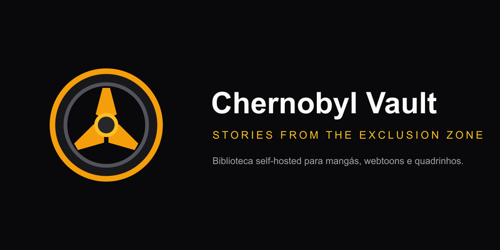

<p align="center">
  
</p>

<h1 align="center">Chernobyl Vault</h1>

<p align="center"><strong>Seu acervo de histórias na Zona de Exclusão.</strong></p>

<p align="center">
  <a href="https://github.com/lukasspires/chernobyl-vault/actions/workflows/ci.yml"></a>
  <a href="LICENSE"></a>
  
</p>

Biblioteca web self-hosted para organizar e ler mangás, webtoons, comics e HQs. O Chernobyl Vault indexa arquivos locais, preserva o progresso de leitura e pode importar capítulos de fontes remotas compatíveis.



> [!WARNING]
> O aplicativo não possui autenticação. Use-o apenas em uma rede local confiável ou por VPN, como Tailscale ou WireGuard. Não exponha a porta diretamente à internet pública.

## Funcionalidades

- Biblioteca de CBZ, ZIP, CBR, RAR, PDF e pastas de imagens
- Leitura LTR, RTL e vertical contínua, com zoom, fullscreen, teclado e toque
- Progresso, histórico, favoritos, tags e busca
- Metadados opcionais via MyAnimeList e ComicVine
- Catálogo MangaDex com filtros, idiomas e economia de dados
- Importação por URL de leitores HTML, WordPress e Madara compatíveis
- Downloads retomáveis e importação automática na biblioteca
- Interface responsiva com temas claro e escuro

## Início rápido com Docker

Requisitos: Docker e Docker Compose.

```bash
cp .env.example .env
docker compose up -d --build
```

Configure a biblioteca no `.env`:

```env
# Windows
LIBRARY_PATH=C:\Mangas

# Linux
LIBRARY_PATH=/mnt/nas/comics
```

Acesse <http://localhost:3000>, abra **Configurações**, confirme os caminhos e selecione **Reescanear** na Biblioteca.

Os volumes do Compose mantêm os dados em `./data` e montam a biblioteca como somente leitura em `/library`.

## Desenvolvimento

Requisitos: Node.js 22.19 ou superior e npm.

```bash
# terminal 1
cd backend
npm ci
npm run dev

# terminal 2
cd frontend
npm ci
npm run dev
```

O frontend fica em <http://localhost:3000> e encaminha `/api` para o backend em <http://localhost:3001>.

### Verificação completa

```bash
cd backend && npm test && npm run build
cd ../frontend && npm test && npm run build
cd .. && docker compose config --quiet
docker build -t chernobyl-vault:local .
```

## Compatibilidade com instalações anteriores

Na primeira inicialização, o banco legado `data/manga-reader.db` é migrado para `data/chernobyl-vault.db`. Preferências salvas no navegador sob `manga-reader-settings` também são transferidas automaticamente. A migração nunca substitui um banco ou configuração que já exista com o nome novo.

## Organização da biblioteca

```text
Biblioteca/
├── One Piece/
│   ├── 001.cbz
│   └── 002.cbz
├── Berserk/
│   └── Vol 01/
│       ├── 001.png
│       └── 002.png
└── Spider-Man 001.cbr
```

Séries são agrupadas pela pasta de primeiro nível. Arquivos soltos na raiz são tratados como séries individuais.

## Uso responsável

Baixe ou importe somente conteúdo que você tem autorização para usar. O Chernobyl Vault não contorna login, CAPTCHA, paywall ou DRM e não inclui obras protegidas no repositório.

## Segurança e contribuições

- Leia [SECURITY.md](SECURITY.md) antes de relatar uma vulnerabilidade.
- Consulte [CONTRIBUTING.md](CONTRIBUTING.md) para preparar mudanças.
- A participação segue o [Código de Conduta](CODE_OF_CONDUCT.md).

## Licença

Distribuído sob a [GNU Affero General Public License v3.0](LICENSE). Modificações disponibilizadas por uma rede também devem oferecer o código-fonte correspondente aos usuários.
